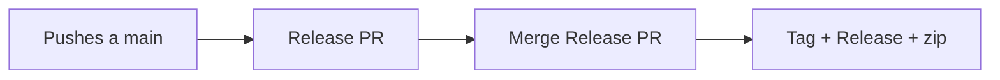

# GitHub Releases — guía fácil (CustomItemForge)

[English](GITHUB_RELEASES.md) · [Español](GITHUB_RELEASES_ES.md)

Esta guía es para **ti** (quien publica). Los usuarios solo descargan el zip.

## Flujo normal (release-please)

1. Trabajas y mergeas a `main` con **Conventional Commits** (`feat:`, `fix:`, …).
2. El workflow **Release Please** abre o actualiza una **Release PR** (versión + `CHANGELOG.md`).
3. Cuando quieras sacar un alpha: **mergeas esa Release PR**.
4. Eso crea el tag (`vX.Y.Z-alpha.N`), la GitHub Release (marcada como **prerelease**) y en el mismo job genera y sube el `.zip` (~5 min).

No hace falta crear la Release a mano en la UI.



### Ver progreso

1. **Actions** → **Release Please** (abre/actualiza la PR o publica)
2. Tras el merge de la Release PR, en esa misma ejecución mira los pasos de build/upload del zip
3. **Releases** → Assets → `CustomItemForge-*.zip`

### Conventional Commits (obligatorio)

Sin estos prefijos, release-please no sabe cuándo subir versión:

| Prefijo | Efecto (0.x + alpha) |
|---|---|
| `feat:` | bump (patch / alpha) |
| `fix:` | bump (patch / alpha) |
| `feat!:` o `BREAKING CHANGE:` | bump minor (pre-major) |
| `docs:`, `chore:`, `ci:` | sin release |

Ejemplos:

```text
feat: add clothing merge preview
fix: prevent crash when material slot is missing
docs: clarify calibration sample layout
```

### Salir de alpha (más adelante)

En [`release-please-config.json`](../../release-please-config.json), quita o pon `"prerelease": false` (y ajusta `prerelease-type` si aplica). Las siguientes releases dejarán de ser alpha/prerelease.

---

## Regenerar el zip de una release que ya existe

Workflow: **Release CustomItemForge**  
Archivo: `.github/workflows/release-custom-item-forge.yml`

### Opción A — Re-run

1. **Actions** → la ejecución que subió el zip → **Re-run all jobs**

### Opción B — Run workflow (recomendado)

1. **Actions** → **Release CustomItemForge** → **Run workflow**
2. Escribe el tag exacto (ej. `v0.1.1-alpha.1`)
3. Espera ~5 min → el zip se sustituye (`--clobber`)

---

## Release manual (solo si hace falta)

Si publicas una Release a mano en la UI, **Release CustomItemForge** también se dispara (`release: published`) y sube el zip. El camino feliz es release-please.

---

## Checklist rápido

| Quiero… | Hago… |
|---|---|
| Preparar el próximo alpha | Commits convencionales a `main` → revisar Release PR |
| Publicar alpha | Mergear la Release PR |
| Ver si va bien | Actions → Release Please |
| Regenerar zip del mismo tag | Run workflow en Release CustomItemForge |
| Probar zip en local | `python scripts/build_release.py --zip --tag vX.Y.Z-alpha.N` |

---

## Windows: GUI sin consola

- Abre la app con **`CustomItemForge_Win.pyw`** (doble clic).
- **No** abras `CustomItemForge.pyz` para la GUI: eso abre una ventana de consola.
- El `.pyz` es solo para la **línea de comandos**.

Más detalle del build local: [RELEASE.md](RELEASE.md).
